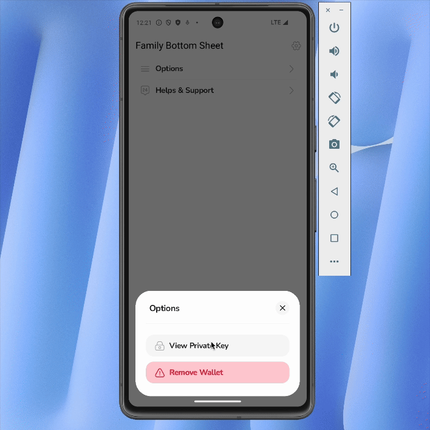

# Family Bottom Sheet

Multi-page modal sheets for Flutter. Pages push and pop inside one sheet, keep their state, and the sheet resizes smoothly between them. How it looks is entirely up to you.

## Inspired by Family's App Design System

This library started as a clone of the dynamic tray system in the [Family](https://family.co/) app, where one sheet carries a whole flow instead of a single static view.

## What you get

- **Pages keep their state.** A page stays mounted while it's in the stack, so its scroll position, text and controllers are still there when you pop back to it.
- **Your own look.** The package draws nothing. Give it a `surfaceBuilder` for the background, shape, padding and drag handle, and a `pageTransitionBuilder` for how pages move.
- **Docked, floating or adaptive.** Show the same pages as a sheet against the bottom edge, a sheet floating in the middle (the tablet sheet), or let `adaptive` dock on phones and float on tablets. It follows the window live: resize it or rotate the device and the sheet moves, with every page keeping its state. Or pick with your own rule.
- **Set it once.** A `FamilySheetTheme` holds your app-wide defaults, so a call is just `show(context:, builder:)`.
- **Lists and drag-to-close work together.** Pull a list down from its top and the sheet follows your finger. Push back up and the list scrolls again, like iOS sheets.
- **Feels native.** Springs carry the speed of your finger when you let go of a drag. Dragging past fully open stretches the sheet like a rubber band, and a sheet that can't close gives a little and springs back instead of feeling stuck.
- **Back works as expected.** The system back gesture pops a page first and closes the sheet from the first page. Tapping outside or dragging down closes the whole sheet.
- **No Material required.** The core only uses `widgets.dart`. A Material preset is available as a separate import.

## Get Started

```bash
flutter pub add family_bottom_sheet
```

1.0 is in pre-release. To try it, ask for the dev version explicitly; a plain `pub add` stays on 0.1.0:

```bash
flutter pub add family_bottom_sheet:^1.0.0-dev.1
```

The API may still change between dev versions. Feedback is welcome in [issues](https://github.com/danielkiing3/family_bottom_sheet/issues).

## Demo
</br>
</br>



## Usage

### 1. Set your look once

Put a `FamilySheetTheme` above your app, for example in `MaterialApp.builder`. Every sheet below it uses these defaults.

```dart
MaterialApp(
  builder: (context, child) => FamilySheetTheme(
    data: FamilySheetThemeData(
      presentation: const FamilyPresentationStyle.adaptive(),
      surfaceBuilder: (context, child) => Material(
        color: Colors.white,
        borderRadius: BorderRadius.circular(36),
        clipBehavior: Clip.antiAlias,
        child: child,
      ),
    ),
    child: child!,
  ),
  home: const HomeScreen(),
);
```

`child` in the `surfaceBuilder` is the page stack. Wrap it in whatever your design calls for: background, shape, padding, drag handle, shadow. Without a `surfaceBuilder` you get a plain white surface with rounded corners.

The core doesn't add a `Material` widget. If your pages use Material widgets such as `TextField`, `InkWell` or `ListTile`, or rely on the theme's text style, make `Material` part of your surface as above. Without it you'll see "No Material widget found" from text fields, and yellow underlined text.

### 2. Show it

```dart
await FamilyModalSheet.show<void>(
  context: context,
  builder: (context) => const FirstPage(),
);
```

Anything you pass to `show` overrides the theme for that call, and anything neither sets falls back to the package default.

### 3. Move between pages

```dart
final stack = FamilyModalSheet.of(context);

stack.pushPage(const SecondPage());
stack.popPage();
stack.replacePage(const SuccessPage()); // swap the top page, e.g. a form for its success page
stack.popToFirstPage();

stack.pageCount;   // number of pages
stack.canPopPage;  // false when popPage() would close the sheet
```

Popping the last page closes the sheet. `pushPage` returns a future that completes with the value passed to `popPage`, so a page can hand a result back:

```dart
final colour = await FamilyModalSheet.of(context).pushPage<Color>(const ColourPicker());

// In ColourPicker:
FamilyModalSheet.of(context).popPage(Colors.teal);
```

### Docked, floating or adaptive

```dart
// A sheet against the bottom edge (the default)
presentation: const FamilyPresentationStyle.sheet(),

// A sheet floating in the middle of the screen, the usual tablet sheet
presentation: const FamilyPresentationStyle.sheet(
  placement: FamilySheetPlacement.floating(),
),

// Docked on phones, floating from 600 wide, switching live
presentation: const FamilyPresentationStyle.adaptive(),
```

A floating sheet behaves exactly like a docked one: it slides up from the bottom of the screen, swipes down to close, hands off from a scrolling list, stretches like a rubber band and respects `canUserDismiss`. Only where it rests differs.

**Settings that apply to both placements** go on `sheet` and `adaptive`: `enableDrag`, `dragFromScroll` (pulling a list down from its top drags the sheet; on by default), `useSafeArea`, `maxHeightFactor`, `motion`.

**Settings that only apply to one placement** live on the placement:

- `FamilySheetPlacement.docked(maxWidth: 640)`: the widest it gets; it's centred on wider screens.
- `FamilySheetPlacement.floating(maxWidth: 540, anchor: FamilyAnchor.top, insetPadding: EdgeInsets.all(24))`. `anchor` picks the edge that stays still as the sheet resizes between pages: `top` by default, so the header doesn't move, or `center` or `bottom`. It opens centred; a page that doesn't fit slides it just enough, and it stays there until the screen's width changes.

`adaptive` takes the shared settings once, plus `breakpoint` and a placement for each side:

```dart
const FamilyPresentationStyle.adaptive(
  breakpoint: 600,
  motion: FamilyMotion.spring(bounce: 0.1),
  docked: FamilySheetPlacement.docked(maxWidth: 480),
  floating: FamilySheetPlacement.floating(maxWidth: 600, anchor: FamilyAnchor.center),
)
```

It re-checks on every layout, so split view, Stage Manager, desktop window resizing and rotation move the sheet while it's open, even mid-drag. The pages and their state stay as they are.

#### Your own rule

`resolve` picks the presentation with your own function, asked again on every layout. It can return anything, `adaptive` included:

```dart
// Floating in landscape, docked in portrait
FamilyPresentationStyle appPresentation(BuildContext context) =>
    MediaQuery.orientationOf(context) == Orientation.landscape
        ? const FamilyPresentationStyle.sheet(
            placement: FamilySheetPlacement.floating(),
          )
        : const FamilyPresentationStyle.adaptive();

presentation: const FamilyPresentationStyle.resolve(appPresentation),
```

Define the function once, as a top-level or static function, not inline in `build`. A function written inline is a new one on every rebuild, so a `FamilySheetTheme` holding it would count as changed every time and rebuild every open sheet.

#### Changing one setting for one sheet

`copyWith` changes the shared settings on any presentation, including whatever a `resolve` picks. Combined with the theme, it changes one thing for one sheet without repeating the rest:

```dart
presentation: FamilySheetTheme.of(context).presentation.copyWith(enableDrag: false),
```

#### Adapting your surface

Read `FamilyPresentation.maybeOf(context)` to adapt a surface or a page: `docked` or `floating`. For example, round every corner and drop the drag handle when floating:

```dart
Widget mySurface(BuildContext context, Widget child) {
  final docked = FamilyPresentation.maybeOf(context) == FamilyPresentation.docked;
  return MyCard(allCorners: !docked, showDragHandle: docked, child: child);
}
```

### Page transitions

The default is a cross-fade. `FamilyPageTransitions.fadeThrough()` adds a slight slide. For your own, pass a `pageTransitionBuilder`. It works like a `PageRoute`'s: `animation` goes from 0 to 1 as the page is pushed, and `secondaryAnimation` goes from 0 to 1 as another page covers it.

```dart
pageTransitionBuilder: (context, animation, secondaryAnimation, child) {
  return FadeTransition(opacity: animation, child: child);
},
pageMotion: const FamilyMotion.spring(duration: Duration(milliseconds: 300)),
```

Return the same widget shape every time, so the page keeps its state.

### All `show` options

- `builder`: the first page.
- `presentation`: a sheet (docked or floating), adaptive, or your own rule with `resolve`. Defaults to a docked sheet.
- `surfaceBuilder`: your surface around the pages.
- `pageTransitionBuilder`, `pageMotion`: how pages animate, and how the sheet resizes between them.
- `barrierColor`, `barrierLabel`, `isDismissible`: the barrier behind, and whether tapping it closes the sheet.
- `useRootNavigator`: whether to show the sheet over every nested navigator. Defaults to false.
- `routeSettings`, `anchorPoint`, `semanticsLabel`.

`presentation`, `surfaceBuilder`, `pageTransitionBuilder`, `pageMotion`, `barrierColor` and `isDismissible` can also be set in `FamilySheetThemeData`.

### Motion

Sheets and pages move with springs by default. A spring keeps the speed of your finger when you let go of a drag, so the sheet carries on from where you threw it.

```dart
FamilyMotion.spring(duration: Duration(milliseconds: 400), bounce: 0)  // the sheet default
FamilyMotion.spring(duration: Duration(milliseconds: 450), bounce: 0.3) // playful
FamilyMotion.curved(Duration(milliseconds: 250), curve: Curves.easeOut) // a fixed-length animation
```

Pass one as `motion` on a presentation style, or as `pageMotion` for the pages. Transitions receive animations already shaped by the motion, so they shouldn't add a curve of their own.

### Blocking closing

Override `canUserDismiss` on `FamilyModalRoute` (the route `show` pushes) to stop the user closing it, for example while a payment is in flight. Tapping outside, dragging and going back (including popping pages with back) then do nothing. Closing from code with `Navigator.pop` still works.

```dart
class PaymentSheetRoute<T> extends FamilyModalRoute<T> {
  PaymentSheetRoute({required super.builder});

  bool _isProcessing = false;

  @override
  bool get canUserDismiss => !_isProcessing;

  void setProcessing(bool value) {
    _isProcessing = value;
    changedInternalState(); // so the barrier updates
  }
}
```

### Returning a result

`show` completes with whatever the sheet is closed with. On the first page, `popPage(value)` closes the sheet with `value`:

```dart
final colour = await FamilyModalSheet.show<String>(
  context: context,
  builder: (_) => const ColourPage(),
);

// In ColourPage:
FamilyModalSheet.of(context).popPage('Teal');
```

### Material preset

```dart
import 'package:family_bottom_sheet/material.dart';

// App-wide
FamilySheetThemeData(surfaceBuilder: FamilyMaterialSheet.surface(showDragHandle: true))

// One-off
await FamilyMaterialSheet.show<void>(context: context, builder: (_) => const FirstPage());
```

Docked, it's the standard Material bottom sheet: it touches the bottom and sides of the screen, rounds only its top corners (28), and runs its colour behind the home indicator while keeping the pages above it. Floating, it rounds every corner and drops the drag handle.

- `padding`: space around a docked sheet. Zero by default, so it's flush; set it to float the docked sheet as a card, with every corner rounded.
- `borderRadius`: the docked sheet's corners. Defaults to the top corners when flush and all corners with padding.
- `floatingBorderRadius`: the floating sheet's corners. Defaults to all corners.
- `backgroundColor`, `elevation`, `showDragHandle`.

```dart
// The card look: a margin, and every corner rounded
FamilyMaterialSheet.surface(
  padding: const EdgeInsets.fromLTRB(16, 0, 16, 16),
  borderRadius: BorderRadius.circular(36),
)
```

### Your own container

`FamilyPageStack` is the page stack on its own: no route and no visuals. Use it inside your own route, panel or side sheet, and `FamilyModalSheet.of(context)` works the same from its pages.

```dart
FamilyPageStack(initialPage: const FirstPage())
```

If you host it in your own modal route, make tapping the barrier pop the route directly. Otherwise the barrier's back action pops a page instead.

## Migrating from 0.x

1.0.0 is a rewrite. Pages now keep their state and `initState` runs once per page, where 0.x rebuilt them on every switch.

| 0.x | 1.0.0 |
|---|---|
| `show(contentBackgroundColor: …, mainContentBorderRadius: …, mainContentPadding: …)` | `show(surfaceBuilder: …)`, or once in a `FamilySheetTheme`, and draw those in your surface |
| pages relied on the sheet's built-in `Material` | wrap your surface in `Material` (see Usage) |
| `showMaterialDefault(…)` | `FamilyMaterialSheet.show(…)` from `package:family_bottom_sheet/material.dart` |
| `backgroundColor`, `elevation`, `shape`, `clipBehavior`, `showDragHandle` | your surface |
| `constraints` | for width, `FamilySheetPlacement.docked(maxWidth: …)`; anything else, a `ConstrainedBox` in your surface |
| `enableDrag`, `useSafeArea`, `sheetAnimationStyle` | `presentation: FamilyPresentationStyle.sheet(enableDrag: …, useSafeArea: …, motion: …)` |
| `isScrollControlled`, `scrollControlDisabledMaxHeightRatio` | `FamilyPresentationStyle.sheet(maxHeightFactor: …)` |
| `safeAreaMinimum` | a `SafeArea(minimum: …)` in your surface |
| `mainContentAnimationStyle` | `pageMotion` |
| `transitionAnimationController` | removed |
| `pageAnimationStyle`, `sheetAnimationStyle`, `AnimationStyle` | `pageMotion` and the presentation's `motion`, both `FamilyMotion` |
| `canPopPage()` / `getTotalPageCount()` | `canPopPage` / `pageCount` getters |
| `pushPage` / `popPage` | unchanged; `pushPage` now returns a future with the popped result |

Requires Flutter 3.32 or later.

# Inspiration
This package is inspired by the Family app's bottom sheet design system, where bottom sheets act as dynamic navigation surfaces for key user flows.

This package is also inspired by work by the Wolt team on wolt_modal_sheet package

# Contributors
- [Aurélien Lepage](https://github.com/MrLepage)

## Contributing
If you have a suggestion that would make this better, please fork the repo and create a pull request. You can also simply open an issue with the tag "enhancement". Don't forget to give the project a star! Thanks again!

1. [Fork the family_bottom_sheet repo](https://github.com/danielkiing3/family_bottom_sheet/fork) on GitHub.
2. Clone your forked repo locally.
3. Create a new branch from the `main` branch.
4. Make your changes.
5. Create a pull request.
